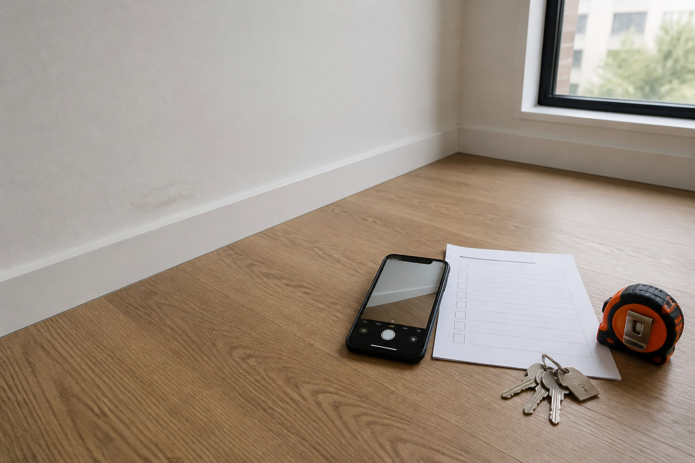

# RoomReceipt

[](https://github.com/KanadeK/roomreceipt/actions/workflows/ci.yml)
[](https://github.com/KanadeK/roomreceipt/actions/workflows/codeql.yml)
[](https://kanadek.github.io/roomreceipt/)
[](LICENSE)

[Live demo](https://kanadek.github.io/roomreceipt/) | [Sample report](https://kanadek.github.io/roomreceipt/demo/) | [简体中文](README.zh-CN.md)



RoomReceipt turns move-in and move-out photos into an offline, tamper-evident evidence bundle. It copies original image bytes into a clear case structure, records capture metadata and SHA-256 fingerprints, pairs repeatable views, produces a printable report, and ships an independent verifier for both directories and ZIP bundles.

It is a real CLI, not a form mockup. The comparison engine reads actual pixels. The verifier reads actual bytes. Any missing, changed, unlisted, duplicated, or path-unsafe ZIP member fails verification.

## Why this exists

Official rental guidance repeatedly recommends detailed condition reports, dated photographs, and copies kept by both parties. Examples include [NSW Fair Trading](https://www.nsw.gov.au/housing-and-construction/rules/rental-property-condition-reports), [Consumer Affairs Victoria](https://www.consumer.vic.gov.au/housing/renting/rent-bond-bills-and-condition-reports/condition-reports), and the [UK government renting checklist](https://www.gov.uk/government/publications/how-to-rent/how-to-rent-the-checklist-for-renting-in-england).

The workflow is still often a camera roll plus a document assembled later. Commercial apps exist, but the August 2026 search described in [docs/research.md](docs/research.md) did not find a mature, offline, open-source project centered on deterministic pairing, portable byte-level verification, and a transparent claims boundary.

RoomReceipt fills that narrower gap. It does not give legal advice or decide whether a visual change is damage.

## What works today

- Create a case and stable room, item, and view slots.
- Add one photo or atomically import a CSV manifest.
- Preserve the original image bytes and extract dimensions, MIME type, EXIF capture time, timezone presence, and GPS presence.
- Pair move-in and move-out images by stable slot key.
- Calculate normalized pixel difference, changed-pixel ratio, and perceptual hash distance.
- Generate deterministic visual difference aids without calling an AI service.
- Audit missing views, changed files, weak metadata, low resolution, duplicate bytes, and stale seals.
- Seal a case with SHA-256 and verify it later.
- Generate a dual-theme, printable local HTML report.
- Create a deterministic `.roomreceipt.zip` with its own manifest and case seal.
- Reject ZIP path traversal, duplicate names, unlisted members, missing members, and hash mismatches.

## Quick start

Requirements: Python 3.11 or newer. [`uv`](https://docs.astral.sh/uv/) is recommended.

Install the tagged GitHub release:

```bash
uv tool install "git+https://github.com/KanadeK/roomreceipt.git@v0.1.0"
roomreceipt --version
```

Or work from a clone:

```bash
git clone https://github.com/KanadeK/roomreceipt.git
cd roomreceipt
uv sync --all-extras
uv run roomreceipt --version
```

### Run the complete synthetic example

The committed example contains eight generated JPEG fixtures with fixed EXIF timestamps. No real person, address, or tenancy is represented.

```bash
uv run python scripts/generate_example_data.py --check
uv run python scripts/build_example.py --output build/bright-street
uv run roomreceipt verify build/bright-street/bright-street-demo.roomreceipt.zip
```

Open `build/bright-street/report/index.html` locally. Expected verification output begins with:

```text
verified 29 files:
```

## Build a real case

Create the case:

```bash
roomreceipt init apartment-case \
  --title "Apartment move-in" \
  --property "14 Bright Street" \
  --unit "4B"
```

Add one image. The stable `--slot` value is reused for the matching move-out view:

```bash
roomreceipt add apartment-case move-in IMG_1001.jpg \
  --slot living-north-wall \
  --room "Living room" \
  --item "North wall" \
  --view "Wide" \
  --note "Light scuff above baseboard" \
  --captured-at "2026-03-01T09:12:00-08:00"
```

Import a batch:

```bash
roomreceipt import apartment-case move-in move-in.csv
roomreceipt import apartment-case move-out move-out.csv
```

Required CSV columns are `source`, `slot`, `room`, `item`, and `view`. Optional columns are `note` and `captured_at`.

```csv
source,slot,room,item,view,note,captured_at
photos/living-wide.jpg,living-north-wall,Living room,North wall,Wide,Light scuff,2026-03-01T09:12:00-08:00
```

Build the review artifacts:

```bash
roomreceipt compare apartment-case
roomreceipt audit apartment-case
roomreceipt seal apartment-case
roomreceipt report apartment-case
roomreceipt bundle apartment-case
roomreceipt verify apartment-case
roomreceipt verify apartment-case/apartment-move-in.roomreceipt.zip
```

Use `roomreceipt audit apartment-case --strict` when warnings such as missing timezone or missing move-out views should fail automation.

## What the outputs mean

```text
apartment-case/
├── case.json                  # case metadata and evidence register
├── evidence/
│   ├── move-in/               # copied original bytes
│   └── move-out/
├── comparison.json            # numeric review aids and pair status
├── comparison-assets/         # generated difference images
├── seal.json                  # SHA-256 case seal
├── report/
│   ├── index.html             # printable report
│   ├── report.json
│   └── assets/                # report thumbnails and diffs
└── <case-id>.roomreceipt.zip  # portable deterministic bundle
```

The original evidence files are never rewritten during import. Report thumbnails and difference aids are separate generated files.

## Integrity boundary

A successful verification proves only this:

> The bytes listed by the seal still match their recorded size and SHA-256 value at verification time.

It does not prove:

- when a camera captured the image;
- who captured or authored it;
- that it was never edited before the first seal;
- that EXIF metadata is truthful;
- that a visual change is damage;
- who caused a change;
- legal admissibility or the outcome of a dispute.

See [docs/threat-model.md](docs/threat-model.md) for the complete model.

## Exit codes

| Command outcome | Exit code |
| --- | ---: |
| Success | `0` |
| Audit or verification found a failing condition | `1` |
| Invalid input, invalid case, or unsafe path | `2` |

## Acceptance commands

From a clean clone:

```bash
uv sync --all-extras
uv run python scripts/release_check.py
```

The release check runs all of these gates:

- Ruff lint and formatting;
- strict mypy;
- 90% branch-aware coverage;
- 48 unit, integration, CLI, tamper, and archive safety tests at initial release;
- deterministic example regeneration;
- two deliberately separated example bundle builds with byte equality;
- directory and ZIP verification;
- site accessibility and local-link checks;
- secret pattern scan;
- wheel and source distribution build;
- Twine metadata validation;
- clean virtual-environment wheel installation and CLI smoke test;
- release asset SHA-256 manifest validation.

## When acceptance fails

Start with the exact failed line. Do not reseal or regenerate evidence just to make a mismatch disappear.

| Failure | Likely cause | Repair |
| --- | --- | --- |
| `uv sync` cannot resolve | stale index or unsupported Python | Run `uv python install 3.12`, then `uv sync --refresh --all-extras`. |
| `HASH_MISMATCH` or `SIZE_MISMATCH` | a sealed file changed | Restore the intended original from backup. If the change was intentional, review it, then run `roomreceipt seal CASE` again. |
| `MOVE_IN_MISSING` | an expected slot lacks baseline evidence | Import the correct move-in file or remove the slot by editing `case.json` only after review. Rerun audit before sealing. |
| `TIMEZONE_UNKNOWN` | common EXIF timestamps have no offset | Corroborate with other records or re-import with an explicit ISO 8601 `captured_at` offset. |
| deterministic example check fails | committed fixture was edited or generated with changed code | Inspect the diff. If the generator change is intentional, run `uv run python scripts/generate_example_data.py`, then review every binary change. |
| `Invalid distribution metadata` | the build backend emitted a metadata version the validation tool does not yet support | Keep the verified Hatchling pin, run `uv lock --check`, then rebuild. Do not skip Twine validation. |
| bundle verification fails after download | transfer corruption or wrong asset | Download again and compare the asset to `SHA256SUMS`. |
| Pages check reports a broken link | generated demo or download is missing | Run `uv run python scripts/build_site.py --output .site-build`, then `uv run python scripts/site_check.py .site-build`. |
| GitHub Actions fails | remote environment differs | Run `gh run list --repo KanadeK/roomreceipt`, then `gh run view RUN_ID --log-failed`. Reproduce locally before changing CI. |

The expanded repair procedure is in [docs/repair.md](docs/repair.md).

## Privacy and safety

- Processing is local and has no telemetry.
- No command uploads evidence.
- GPS values are not printed in the report. The register records only whether GPS metadata is present.
- Reports can still contain addresses, notes, and recognizable interiors. Review them before sharing.
- A bundle contains copied originals. Treat it as sensitive.
- Symlink and ZIP path escape attempts are rejected by the verifier.

Security reports are handled through [SECURITY.md](SECURITY.md).

## Documentation

- [Architecture](docs/architecture.md)
- [Case and bundle formats](docs/case-format.md)
- [Threat model](docs/threat-model.md)
- [Research and differentiation](docs/research.md)
- [Repair playbook](docs/repair.md)
- [Asset provenance](docs/asset-provenance.md)

## Development

```bash
uv sync --all-extras
uv run ruff check .
uv run ruff format --check .
uv run mypy src
uv run pytest --cov=roomreceipt --cov-report=term-missing
```

Contributions are welcome. Read [CONTRIBUTING.md](CONTRIBUTING.md) and keep the claims boundary intact.

## License

[MIT](LICENSE)
