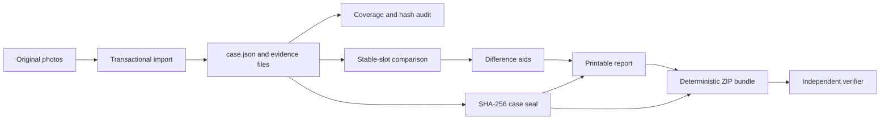

# Architecture

RoomReceipt is a Python 3.11+ package with one runtime dependency, Pillow. The CLI uses `argparse`; JSON and CSV use the standard library.

## Modules

| Module | Responsibility |
| --- | --- |
| `models.py` | Validated case, evidence, finding, and verification types. |
| `paths.py` | Canonical JSON, safe case-relative paths, timestamps, and slugs. |
| `media.py` | Image validation, metadata extraction, perceptual hash, and pixel comparison. |
| `casework.py` | Case creation, slot declarations, single import, and atomic CSV batch import. |
| `audit.py` | Coverage, metadata, duplicate, byte integrity, and seal-state findings. |
| `compare.py` | Move-in and move-out pairing plus review-only difference artifacts. |
| `seals.py` | Domain-separated SHA-256 case roots and directory verification. |
| `report.py` | Static, printable, local HTML report generation. |
| `bundle.py` | Deterministic ZIP assembly, manifest validation, and safe verification. |
| `cli.py` | Stable command and exit-code surface. |

## Invariants

1. Imported original bytes are copied, never re-encoded.
2. One `(phase, slot)` pair maps to at most one evidence entry.
3. A slot has one room, item, and view identity across both phases.
4. JSON is UTF-8, sorted, indented, and newline-terminated.
5. ZIP members use normalized timestamps, permissions, order, and compression.
6. A seal excludes generated report files. Reports can be rebuilt without changing the evidence root.
7. A bundle manifest includes generated outputs and links back to the embedded case seal.
8. Visual comparison can output only `close-match` or `review`. It never outputs a damage or liability verdict.

## Transaction boundary

CSV rows are validated and images are inspected before copying starts. If a copy or final save fails, newly copied batch files are removed. Existing case files are not silently replaced.

Single-file replacement requires the explicit `--replace` flag.
